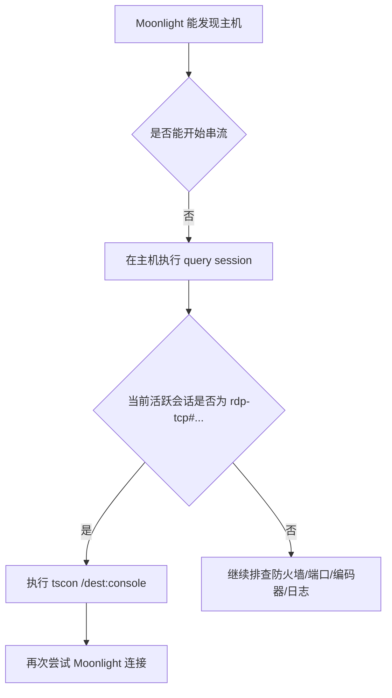

# Sunshine 在 RDP 会话下导致 Moonlight 可发现但无法连接的问题总结

更新时间：2026-04-14

## 问题现象

- 通过 Windows 远程桌面（RDP）连接到主机后启动 Sunshine。
- Moonlight 可以发现该设备，说明主机在线且发现流程基本正常。
- 但 Moonlight 无法正常建立串流连接。
- 执行 `query session` 查看当前会话，并执行 `tscon <sessionID> /dest:console` 后，Moonlight 可以恢复连接。

## 结论

这次问题的根因可以定位为：

> **RDP 改变了 Windows 的活跃图形会话，导致 Sunshine 没有稳定附着在本地 `console` 显示上下文上。**

Moonlight “能发现但连不上” 说明：

- `mDNS` 或局域网发现大概率正常；
- Sunshine 进程大概率也在运行；
- 真正出问题的是 **串流开始阶段的显示捕获/会话上下文**，而不是设备发现阶段。

## 证据链

### 1. `query session` 能区分当前是 `console` 还是 `rdp-tcp#...`

Microsoft 官方文档说明，`query session` 用于显示 Remote Desktop Session Host 上的会话信息，并给出示例输出，其中会同时出现 `console` 和 `rdp-tcp#1` 这样的会话名。

这意味着你可以用它直接判断当前活跃图形上下文是否仍停留在 RDP 会话中。

### 2. `tscon <sessionID> /dest:console` 执行后问题立即消失

Microsoft 官方文档说明，`tscon` 用于把一个会话连接到另一个会话，并可通过 `/dest:<sessionname>` 指定目标会话。

结合你的实际结果，可以做出如下推断：

- Sunshine 连接失败时，活跃会话仍是 `rdp-tcp#...`；
- 执行 `tscon <sessionID> /dest:console` 后，交互式图形会话被切回本地控制台；
- Sunshine 重新获得了可用的本地图形桌面，因此 Moonlight 随后恢复正常连接。

这里最后一条是 **结合 Microsoft 命令语义与你现场现象得出的推断**，不是单靠某一页文档中的一句原话。

### 3. Sunshine 官方已经记录过 RDP/Fast User Switching 相关问题

Sunshine 官方 changelog 在 **`0.20.0`（2023-05-28）** 里明确写过一条修复：

- “Fixed streaming after Microsoft Remote Desktop or Fast User Switching has been used”

这说明：

- **RDP/Fast User Switching 影响 Sunshine 串流** 是官方承认过的真实问题；
- 你的现象与该类问题高度一致；
- 如果 Sunshine 版本低于 `0.20.0`，命中已知问题的概率更高。

### 4. Sunshine 在 Windows 下依赖显示设备对应的捕获链路

Sunshine 官方文档说明，在 Windows 上它使用 **Desktop Duplication API**，且该 API 只能捕获“当前用于显示的 GPU/显示输出”。

这意味着一旦 RDP 改写了当前显示会话、显示适配器上下文或活跃桌面，Sunshine 可能会出现：

- 能被发现；
- 但抓屏异常；
- 或建流阶段失败。

这正符合你遇到的“可发现但连不上”的表现。

## 为什么 Moonlight 能发现设备，但还是连不上

这是两个不同阶段：

1. **发现阶段**
   - 依赖局域网发现、主机在线状态、基础网络可达性。
   - 这一阶段成功，所以 Moonlight 能显示主机。

2. **串流建立阶段**
   - 依赖 Sunshine 的会话状态、显示捕获、编码器、权限和端口可用性。
   - 这一阶段失败，所以 Moonlight 无法真正进入桌面或应用流。

因此，“设备能看到”不能说明 Sunshine 已经拿到了可用桌面。

## 针对本次问题的最终定位

结合现象和官方资料，本次问题最合理的定位是：

1. 你通过 RDP 登录到 Windows 主机。
2. Windows 把当前交互式显示上下文保留在 `rdp-tcp#...` 会话。
3. Sunshine 处在一个对串流不稳定或不可用的图形会话环境中。
4. Moonlight 虽然能发现主机，但在真正开始串流时失败。
5. `tscon <sessionID> /dest:console` 把会话切回本地控制台后，Sunshine 重新获得了可用显示上下文，因此连接恢复。

## 排除项

这次问题大概率 **不是** 以下原因主导的：

- 不是主机发现失败，因为 Moonlight 已经能显示设备；
- 不是 PIN 配对失败，因为 `tscon` 后无需重新配对即可恢复；
- 不是纯粹的 Sunshine 未启动，因为问题会随着会话切换立即恢复；
- 不是单纯局域网不通，因为 `query session`/`tscon` 能稳定改变结果。

## 建议的长期处理方式

### 1. 使用 Sunshine Service，而不是在 RDP 里手动多开实例

Sunshine 官方在 **`0.20.0`（2023-05-28）** 开始强调：

- Windows 安装器版本应由 `Sunshine Service` 启动；
- 不再支持从 `Program Files` 手动直接启动 `Sunshine.exe`；
- 不建议多开 Sunshine 实例。

因此更稳妥的做法是：

- 让 `SunshineService` 常驻；
- 只通过 Web UI 管理 Sunshine；
- 避免在 RDP 会话中手工额外启动一个 Sunshine 进程。

### 2. 断开 RDP 前切回控制台会话

如果你仍需要通过 RDP 维护主机，可以在退出前执行：

```bat
query session
tscon <sessionID> /dest:console
```

其中 `<sessionID>` 用 `query session` 或 `query user` 查看。

### 3. 给主机保留一个稳定的本地显示输出

如果主机经常无显示器运行，建议：

- 连接真实显示器，或
- 使用 HDMI/DP dummy plug。

这样能减少 Sunshine 在 Windows 下因无有效显示输出而抓屏失败的概率。

### 4. 检查 Sunshine 的捕获方式

Sunshine 官方配置文档写明：

- `ddx`（Desktop Duplication）是 Windows 上常用且支持较好的方式；
- `wgc`（Windows.Graphics.Capture）**不兼容 Sunshine service**。

如果你的 Sunshine 以 service 方式运行，又手动切成了 `wgc`，可能会进一步放大异常。

## 简版诊断流程



## 可直接复用的排查命令

```bat
query session
query user
tscon <sessionID> /dest:console
```

如果后续还要继续排查，可再检查：

```bat
sc query SunshineService
netstat -ano | findstr 47984
netstat -ano | findstr 47989
netstat -ano | findstr 47990
```

## 参考资料

### Microsoft 官方文档

- `query session`
  https://learn.microsoft.com/en-us/windows-server/administration/windows-commands/query-session

- `tscon`
  https://learn.microsoft.com/en-us/windows-server/administration/windows-commands/tscon

### Sunshine 官方文档

- Sunshine changelog
  https://docs.lizardbyte.dev/projects/sunshine/v0.23.1/history/changelog.html

- Sunshine Usage（Windows、Service、Desktop Duplication 说明）
  https://docs.lizardbyte.dev/projects/sunshine/v0.21.0/about/usage.html

- Sunshine Configuration（`wgc` 与 service 兼容性）
  https://docs.lizardbyte.dev/projects/sunshine/v2026.213.34323/md_docs_2configuration.html

- Sunshine 项目主页 / 功能兼容性总览
  https://docs.lizardbyte.dev/projects/sunshine/master/

### Moonlight 官方资料

- Moonlight Setup Guide
  https://github.com/moonlight-stream/moonlight-docs/wiki/Setup-Guide

## 一句话总结

这次问题的核心不是“Moonlight 看不到 Sunshine”，而是 **RDP 改变了 Windows 的活跃图形会话，导致 Sunshine 失去了稳定可串流的本地桌面；`tscon` 把会话切回 `console` 后，问题随即恢复。**
